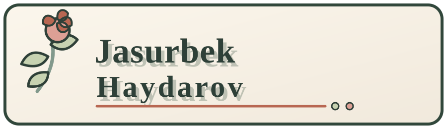

  
   
  
<strong>Software Engineer · Builder · Technical Explorer</strong>

  

    <a href="https://jasurdev.uz">Portfolio</a>
    ·
    <a href="https://github.com/hexjasur?tab=repositories">Repositories</a>
    ·
    <a href="https://t.me/jasurhaydarovcode">Telegram Blog</a>
  

 

  

## Hello, I'm Jasurbek

I build practical software across the web, desktop, and developer-tooling space. My work usually starts with a small idea, grows through hands-on experiments, and ends as something useful enough to share.

I enjoy working with JavaScript and TypeScript, exploring Rust and Tauri for native applications, and turning technical concepts into clear interfaces. This profile is a living garden of projects, experiments, and engineering notes.

### Current focus

- Building focused tools for developers and everyday workflows
- Shipping cross-platform desktop applications with Tauri
- Exploring computational mathematics and interactive learning tools
- Improving AI-assisted development workflows with clear project context
- Writing technical notes from real implementation experience

 

  

## Technologies I use

<a href="#">

</a>

  

## GitHub activity

  
  

  

## Coding activity

  

  

## Connect

  
   
  <a href="https://jasurdev.uz">Portfolio</a> ·
  <a href="https://t.me/KanYonA">Telegram</a> ·

